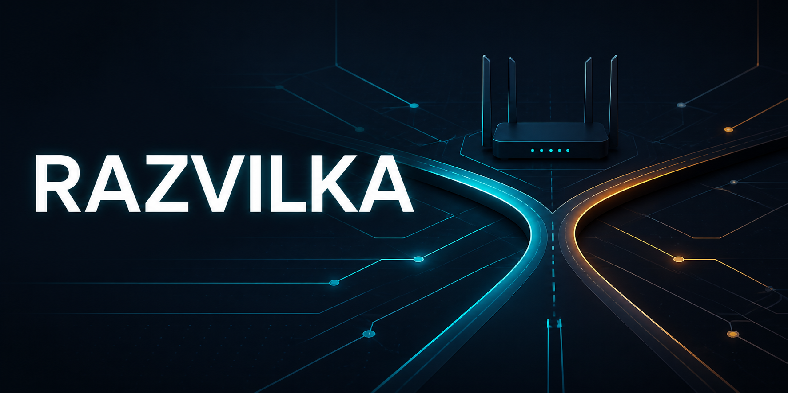
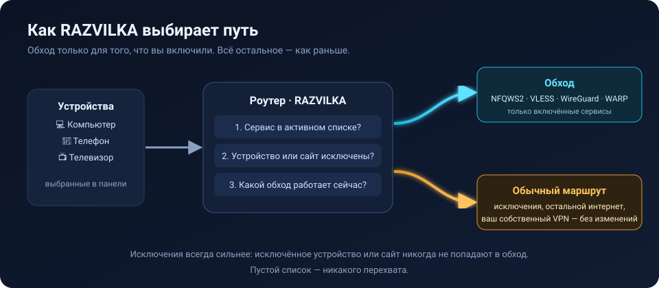
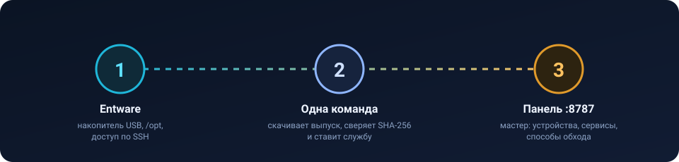

<p align="center">
  
</p>

<p align="center">
  <a href="https://github.com/ArtixSx/RAZVILKA/releases"></a>
  
  
  <a href="LICENSE"></a>
  <a href="https://t.me/RAZVILKA_UI"></a>
</p>

<h3 align="center">Нужные сервисы через подходящее подключение — прямо на роутере</h3>

<p align="center">
  <a href="#установка">Установка</a> ·
  <a href="#обновление">Обновление</a> ·
  <a href="#удаление">Удаление</a> ·
  <a href="#рекомендации">Рекомендации</a> ·
  <a href="docs/INSTALL_RU.md">Подробная инструкция</a> ·
  <a href="README_EN.md">English</a>
</p>

RAZVILKA — локальная веб-панель для роутеров **Keenetic и Netcraze с Entware**.
Вы выбираете сервисы и устройства, а панель подбирает и проверяет способ
доступа: NFQWS2, VLESS, WireGuard/AmneziaWG или WARP. Работает на самом роутере
и по расписанию, даже когда браузер закрыт.

> [!NOTE]
> Готовится выпуск **0.20.0** — это чистая новая база. Что уже проверено на
> настоящем роутере, а что ещё нет, честно описано в [текущем статусе](docs/CURRENT_STATUS_RU.md).
> Команды установки начнут работать после публикации тега `v0.20.0` в
> [Releases](https://github.com/ArtixSx/RAZVILKA/releases).

## Как это работает

<p align="center">
  
</p>

- **Обход только для того, что вы включили.** Сайты и приложения не из списка,
  исключённые устройства и пустой список идут обычным маршрутом роутера,
  включая ваш собственный VPN.
- **Исключения всегда сильнее.** Исключённое устройство или сайт не попадают
  в обход ни вручную, ни автопилотом, ни при восстановлении.
- **Чужие сайты не перехватываются.** Сервисы, заданные доменами, обходятся
  только способом, который проверяет имя сайта в каждом соединении (NFQWS2).
  Перенаправление по IP через VPN или прокси для них отключено: на одном IP
  могут работать посторонние сайты.

## Что умеет

| | |
| --- | --- |
| 🧭 **Автопилот** | Проверяет выбранные сервисы, подбирает рабочий путь, держит резерв и восстанавливается после сбоя — в разрешённых вами пределах |
| 🧩 **Сервисы** | Готовый каталог и свои сервисы; группы; проверка доступа с роутера |
| 🔌 **Подключения** | VLESS/Xray, WireGuard, AmneziaWG, WARP; подписки с проверкой узлов по стране и результату |
| 🛡️ **Обходы DPI** | NFQWS2 со стратегиями, проверка совместимости и подбор |
| 📱 **Устройства** | Выбор домашней сети и устройств, исключения |
| 🧾 **Журнал и диагностика** | Понятные причины ошибок, отчёт для поддержки, резервные копии |
| 🔄 **Обновления** | Ручные и ночные, со снимком настроек и автоматическим откатом |

Состояния «настроено», «маршрут применён» и «сервис доступен» в панели
показываются отдельно: запущенный процесс сам по себе не доказывает, что обход работает.

## Рекомендации

- **Роутер.** Keenetic или Netcraze с USB-накопителем и [Entware](docs/INSTALL_RU.md#подготовка-entware).
  Лучше всего проверен **Netcraze Ultra (NC-1812), ARM64**. Сборки MIPS и MIPSel
  выпускаются, но на физических MIPS-роутерах не проверялись.
- **Накопитель.** Не меньше 1 ГБ свободного места; лучше отдельная флешка или SSD.
- **DNS роутера должен работать** до установки: каталоги, подписки и проверки
  используют его. Ошибка DNS выглядит как недоступность сервиса.
- **Один обход DPI за раз.** Не запускайте z2k или второй nfqws2 параллельно
  с RAZVILKA: два обработчика одной очереди портят соединения.
- **Начните с малого.** Один сервис и одно подключение; проверьте с нужного
  устройства, затем добавляйте остальные.
- **Telegram — через VPN или прокси.** Добавьте из каталога «Telegram · через VPN
  или прокси» (только сети Telegram) и выберите для него узел VLESS. Сервисы,
  заданные доменами (YouTube, Discord и другие), идут через NFQWS2.
- **Банки и Госуслуги — в «Сайты без обхода».** Если сайт открывается и без
  обхода, а с ним работает хуже, добавьте его в «Исключения → Сайты без обхода»
  и нажмите «Применить».
- **Безопасность.** Не открывайте порт панели `8787` в Интернет. Ключ
  восстановления храните отдельно от роутера. Не запускайте общий `opkg upgrade`
  ради панели.

## Установка

<p align="center">
  
</p>

**1. Подготовьте Entware.** Нужен `/opt`, SSH к оболочке Entware от `root`
и средства HTTPS-загрузки:

```sh
opkg update && opkg install curl wget-ssl ca-certificates ca-bundle
```

| Архитектура роутера | Пакет Entware | Сборка RAZVILKA |
| --- | --- | --- |
| AArch64 / ARM64 | [aarch64-k3.10](https://bin.entware.net/aarch64-k3.10/installer/aarch64-installer.tar.gz) | `arm64` |
| MIPS | [mipssf-k3.4](https://bin.entware.net/mipssf-k3.4/installer/mips-installer.tar.gz) | `mips`, soft-float |
| MIPSel | [mipselsf-k3.4](https://bin.entware.net/mipselsf-k3.4/installer/mipsel-installer.tar.gz) | `mipsle`, soft-float |

**2. Установите RAZVILKA одной командой:**

```sh
mkdir -p /opt/tmp &&
curl -fsSL --retry 2 -o /opt/tmp/razvilka-setup.sh \
  https://raw.githubusercontent.com/ArtixSx/RAZVILKA/v0.20.0/scripts/bootstrap.sh &&
sh /opt/tmp/razvilka-setup.sh
```

Установщик сам определит архитектуру, скачает выпуск `v0.20.0`, сверит
SHA-256 и запустит службу. Компоненты обхода ставятся потом из панели.

**3. Откройте панель** — **http://192.168.1.1:8787** (или адрес своего роутера
с портом `8787`; точная ссылка будет в выводе установщика). Войдите по выданному
ключу, задайте пароль, сохраните ключ восстановления и пройдите мастер:
устройства → сервисы → способы обхода.

Где что лежит: настройки — `/opt/etc/razvilka`, рабочие данные —
`/opt/razvilka/{state,run,cache,log}`, снимки обновлений —
`/opt/razvilka/state/update-backups`.

## Обновление

Установленная 0.20+ обновляется **только из панели**: «Обновления» →
«Проверить версию» → «Установить», либо автоматически ночью по выбранному
расписанию. Панель скачивает выпуск с GitHub, проверяет контрольные суммы
и архитектуру, сохраняет снимок настроек и при ошибке возвращает прежнюю версию.

Установщик поверх работающей 0.20+ откажет и ничего не изменит — так обновление
не обходит свой журнал и откат. Проверить версию:

```sh
/opt/bin/razvilka -version
/opt/etc/init.d/S99razvilka status
```

### Переход с 0.19.3 и более ранних версий

0.20.0 ставится **начисто**, без переноса старых настроек. Установщик откажет,
если найдёт старую установку. Порядок перехода: удалить старую версию её
собственным деинсталлятором, затем установить 0.20.0 —
[подробно в инструкции](docs/INSTALL_RU.md#переход-с-0193-и-более-ранних-версий).

## Удаление

```sh
mkdir -p /opt/tmp &&
curl -fsSL --retry 2 -o /opt/tmp/razvilka-setup.sh \
  https://raw.githubusercontent.com/ArtixSx/RAZVILKA/v0.20.0/scripts/bootstrap.sh &&
sh /opt/tmp/razvilka-setup.sh --uninstall
```

Удаляются панель, её автозапуск и собственные маршруты. Настройки, подключения
и резервные копии **сохраняются**. Обычная установка поверх них не выполняется:
установщик увидит журнал прошлой установки и откажет.

Чтобы затем поставить RAZVILKA **заново с нуля**, удалите с переносом данных:

```sh
sh /opt/tmp/razvilka-setup.sh --uninstall --purge
```

`--purge` после удаления **переносит** (не стирает) все данные RAZVILKA в
`/opt/razvilka-removed-<дата>` с доступом только для `root`. Entware,
сторонние программы и установленные пакеты обходов не затрагиваются.

## Поддерживаемые роутеры

| | Состояние |
| --- | --- |
| Netcraze Ultra (NC-1812), ARM64, прошивка 5.01.C.6.0-1 | основной тестовый стенд |
| Другие Keenetic / Netcraze ARM64 с Entware | панель и основной режим «вся сеть»; экспериментальный режим «Домашняя сеть» пока только на NC-1812 |
| MIPS / MIPSel | собираются, на железе не проверялись |

Подробнее — [матрица поддержки](docs/RUNTIME_SUPPORT_RU.md).

## Безопасность и приватность

Панель работает только в вашей сети и защищена паролем. Обновления скачиваются
по HTTPS с проверкой SHA-256 и архитектуры; к выпускам прилагаются аттестации
сборки GitHub. Ключи, пароли и ссылки узлов не попадают в журналы и отчёты.
Подробнее — [SECURITY](SECURITY.md).

## Документация

- [Установка, обновление, удаление и откат](docs/INSTALL_RU.md)
- [Текущий статус и результаты проверок](docs/CURRENT_STATUS_RU.md)
- [Примечания к выпуску 0.20.0](docs/releases/0.20.0.md) · [История изменений](CHANGELOG.md)
- [План развития](docs/ROADMAP.md) · [Идея двух DPI-исполнителей](docs/DUAL_DPI_ARCHITECTURE_RU.md)
- [Что означают файлы и папки](docs/FILES_RU.md) · [Сторонние компоненты](THIRD_PARTY.md)
- [Как помочь проекту](CONTRIBUTING.md)

## Поддержка проекта

Новости, вопросы и предложения — в Telegram **[@RAZVILKA_UI](https://t.me/RAZVILKA_UI)**.
Если RAZVILKA вам помогает — **[поддержать проект](https://dalink.to/artixsx)**.

<p align="center"><sub>MIT · RAZVILKA — «развилка»: каждому сервису — свой путь.</sub></p>
