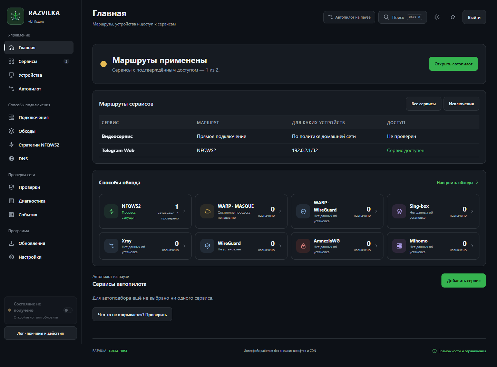

# RAZVILKA

<p align="center"></p>

Локальная панель для роутеров **Keenetic и Netcraze с Entware**. Вы выбираете сервис, например Telegram Web, а панель показывает, какое подключение для него настроено, когда сервис отвечал и есть ли подтверждённый маршрут. Автопилот продолжает проверки после закрытия браузера.

**Тестовый выпуск 0.20.0-rc.128** · [Скачать выпуск](https://github.com/ArtixSx/RAZVILKA/releases/tag/v0.20.0-rc.128) · [Установка](#установка) · [Первый вход](#первый-вход) · [English](README_EN.md)

## Панель



| Раздел | Для чего открыть |
| --- | --- |
| **Главная** | Узнать, остановлен ли проект, какие способы подключения доступны и для скольких сервисов подтверждён доступ. |
| **Сервисы** | Выбрать сайт, увидеть его маршрут, настройки и последний результат проверки. Одноимённые встроенные и пользовательские записи подписаны отдельно. |
| **Подключения** | Добавить свою VLESS-ссылку или посмотреть узлы из публичных источников. |
| **Автопилот** | Передать сервис на автоподбор, посмотреть, какой узел прошёл проверку и какой остался в резерве. |
| **Исключения** | Посмотреть, какие устройства и ресурсы должны сохранить обычное подключение. |

## Что проверено на роутере

На **Netcraze NC‑1812 (ARM64)** в rc.128 проверены установка панели, вход из домашней сети, подбор публичного VLESS для встроенного Telegram Web и штатная остановка через интерфейс. Первый узел не ответил вовремя, второй вернул страницу Telegram Web с ожидаемым содержимым и был сохранён в резерв. От добавления сервиса до результата прошло **2 мин 42 с**. Это результат одного прогона с конкретным источником и сетью. [Отчёт с версией, контрольными суммами и результатами](https://github.com/ArtixSx/RAZVILKA/releases/download/v0.20.0-rc.128/validation-rc128.json)

**В процессе — обход для всей домашней сети (Home).** В этом выпуске автопилот может подтвердить доступ к Telegram Web с роутера через проверенный узел. Применение такого маршрута для всех домашних устройств с сохранением их исключений и собственных VPN-политик ещё проходит испытания. В аппаратной проверке rc.128 панель показала «Узел проверен · маршрут для дома недоступен». Telegram Desktop, звонки и медиатрафик требуют отдельных проверок.

## Установка

Эти команды предназначены для **чистой установки** в работающую Entware на диске, смонтированном в `/opt`. Войдите по SSH под `root` в оболочку Entware, где доступна команда `opkg`. Если уже пользуетесь RAZVILKA, сначала экспортируйте настройки и сохраните резервную копию. Аппаратная проверка rc.128 проведена на NC‑1812. Для других моделей сверяйте архитектуру со списком файлов выпуска.

```sh
export PATH="/opt/sbin:/opt/bin:$PATH"
umask 077
opkg update &&
opkg install curl ca-certificates ca-bundle wget-ssl coreutils-sha256sum coreutils-mktemp &&
mkdir -p /opt/tmp &&
setup="$(mktemp /opt/tmp/razvilka-rc128.XXXXXX)" &&
curl -fsSL --proto '=https' --proto-redir '=https' --retry 2 \
  -o "$setup" https://raw.githubusercontent.com/ArtixSx/RAZVILKA/v0.20.0-rc.128/scripts/bootstrap.sh &&
printf '%s  %s\n' 150bdb2243d65e2a7f9955d2bf36b3b02895bda79e2383751eee0a76c8bb2075 "$setup" | sha256sum -c - &&
RAZVILKA_VERSION=v0.20.0-rc.128 sh "$setup"
```

Команда сверяет SHA‑256 скачанного установщика. Установщик берёт из указанного выпуска архив для Entware и проверяет его контрольную сумму. После установки проверьте версию командой `/opt/bin/razvilka -version`. Ожидаемая версия — `0.20.0-rc.128`. [Архив Entware](https://github.com/ArtixSx/RAZVILKA/releases/download/v0.20.0-rc.128/RAZVILKA-entware.tar.gz) · [SHA‑256 архива](https://github.com/ArtixSx/RAZVILKA/releases/download/v0.20.0-rc.128/RAZVILKA-entware.tar.gz.sha256) · [Все файлы выпуска](https://github.com/ArtixSx/RAZVILKA/releases/tag/v0.20.0-rc.128)

## Первый вход

1. Откройте в домашней сети персональную ссылку из вывода установщика. Задайте пароль для `admin`. При следующих входах используйте адрес `http://<адрес-роутера>:8787`. Пароль можно изменить в настройках панели. Ссылку первого входа храните в секрете.
2. На **Главной** нажмите **Начать настройку** и завершите мастер. Для подбора бесплатных узлов разрешите один из публичных источников VLESS. Свой узел можно добавить в **Подключениях**.
3. Откройте **Автопилот → Сервисы**, выберите **Telegram Web** и нажмите **Передать Автопилоту**. Если у вас есть и собственная запись с таким названием, выбирайте **Telegram Web · встроенный**.
4. Откройте карточку сервиса и дождитесь результата. Если узел прошёл проверку, но маршрут для дома пока недоступен, продолжайте пользоваться текущим подключением. В панели отдельно отображается, применены ли настройки.

## Лицензии

RAZVILKA распространяется по лицензии MIT. Для сторонних программ, данных и наборов стратегий действуют условия их правообладателей. [Лицензия RAZVILKA](LICENSE) · [Сторонние компоненты и данные](THIRD_PARTY.md)
