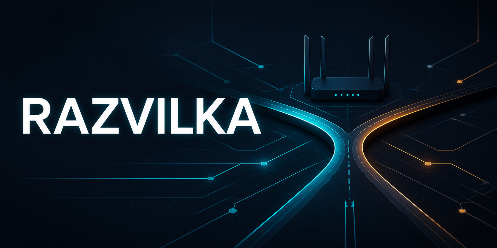
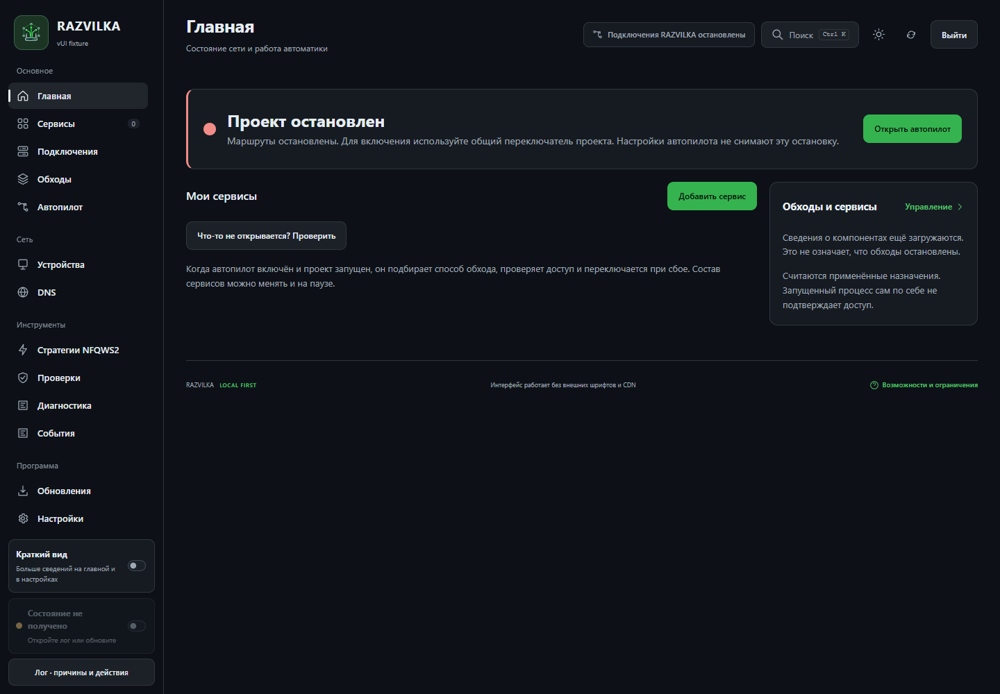
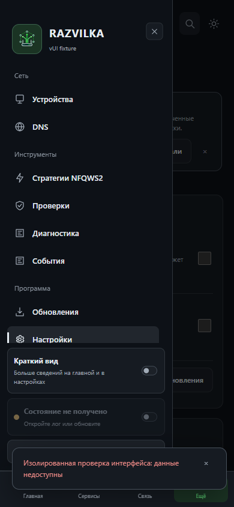
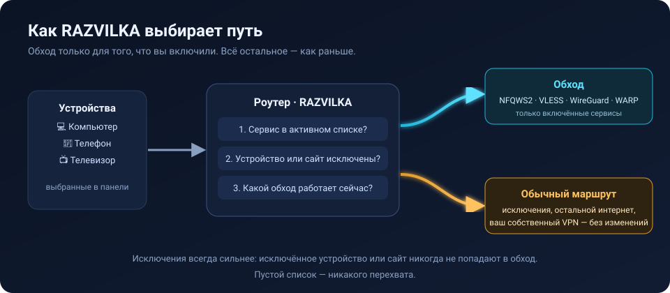

<p align="center">
  
</p>

<p align="center">
  <a href="https://github.com/ArtixSx/RAZVILKA/releases"></a>
  
  
  <a href="LICENSE"></a>
  <a href="https://t.me/RAZVILKA_UI"></a>
</p>

<h3 align="center">Сервисы, подключения и диагностика — в одной панели роутера</h3>

<p align="center">
  <a href="#панель">Панель</a> ·
  <a href="#возможности-и-готовность">Готовность</a> ·
  <a href="#установка">Установка</a> ·
  <a href="#обновление-и-восстановление">Обновление</a> ·
  <a href="docs/INSTALL_RU.md">Инструкция</a> ·
  <a href="README_EN.md">English</a>
</p>

**RAZVILKA** — локальная веб-панель для **Keenetic и Netcraze с Entware**.
Она объединяет каталог сервисов, подключения, подбор стратегий NFQWS2,
проверки доступа и управление маршрутами. Вы задаёте нужные сервисы и область
действия; панель показывает отдельно настройки, применение маршрута и результат
проверки сервиса. Автоматика выполняется на роутере, независимо от открытого браузера.

> **0.20.0 готовится к выпуску.** Текущие исходники и успешный общий CI не
> означают завершённую приёмку всех сетевых сценариев на роутере.
> Устанавливайте только действительно опубликованный выпуск из
> [Releases](https://github.com/ArtixSx/RAZVILKA/releases), следуя его инструкции.
> Если подходящего выпуска нет, готовая установка этой версии пока недоступна.

## Панель

<p align="center">
  
</p>

**13 пунктов меню, четыре понятные группы.** Сервисы, подключения и автопилот
собраны в основном разделе; устройства и DNS — в сетевом. Стратегии NFQWS2,
проверки, диагностика и события доступны напрямую. Обновления и настройки
имеют собственные пункты.

Краткий и подробный вид меняют главную и настройки, сохраняя доступ ко всем
разделам. В диагностике собраны инструменты восстановления HEV/Mihomo.
Меню поддерживает клавиатуру, тёмную и светлую темы, экран компьютера и телефона.
Интерфейс панели обходится без внешних шрифтов и CDN.

<details>
<summary>Меню на телефоне</summary>
<p align="center">
  
</p>
</details>

Снимки сделаны в изолированном браузерном стенде: проект остановлен,
данные смоделированы, недоступность части API показана явно. Проверены
навигация и отображение при 1440×1000 и 390×844; эти снимки не подтверждают
работу маршрутов. [Методика и результаты проверки панели](docs/RESEARCH_LAB_20261109.md#панель-по-референсам-netzapret-1016-ноября).

Группировка меню и визуальная иерархия вдохновлены **NetZapret 1.5.3**.
Реализация использует собственные компоненты RAZVILKA; код, иконки и ресурсы
NetZapret не переносились. [Источник и закреплённая ревизия](docs/RESEARCH_LAB_20261109.md#панель-по-референсам-netzapret-1016-ноября).

## Возможности и готовность

Статус рабочей ветки на **16 ноября 2026**. «Проверено на стенде» относится
к указанному сценарию, а не ко всем моделям роутеров и типам соединений.

| Направление | Что уже есть | Что ещё требуется |
| --- | --- | --- |
| Панель | Новое меню, 21 страница, адаптация к телефону; браузерные и адресные UI-проверки | Проверка установленной сборки вместе с реальным backend роутера |
| Сервисы и автопилот | Каталог, свои сервисы, порядок разрешённых источников, расписание и отображение этапов | Сквозная проверка выбора и переключения на точном LAN-профиле |
| VLESS / Xray / Mihomo | Импорт подключений, проверки сервиса, отдельные проверенные lifecycle-сценарии | Полная приёмка маршрута LAN и оставшихся сценариев восстановления |
| Managed NFQWS2 | Подбор стратегий, точная область действия, контроль очереди, владельцев и очистки | Полный manual/LAN workflow и соблюдение исходных временных бюджетов |
| DNS и доменная маршрутизация | Изолированные проверки точного имени и жизненного цикла DNS | Строгий сценарий DNS → нужный сервис пока не принят; оптимизация продолжается |
| Обновление и backup/restore | Совместимые снимки бинарника и состояния, проверенные сценарии известного отката | Полная проверка повторного offline-восстановления после прерываний и аппаратная приёмка |
| WireGuard / AmneziaWG / WARP | Компоненты, настройка и отдельные проверки | Полная аппаратная приёмка поддерживаемых режимов |

Подробности, точные ревизии и ограничения: [текущий статус](docs/CURRENT_STATUS_RU.md),
[матрица платформ](docs/RUNTIME_SUPPORT_RU.md),
[измерения](docs/measurements/2026-11-16/README.md), [план работ](docs/ROADMAP.md).
Результаты ПК, generic CI, изолированного Linux-стенда и реального router/LAN
учитываются отдельно. Незавершённые сетевые сценарии остаются задачами разработки.

## Как выбирается трафик

<p align="center">
  
</p>

- **Только выбранная область.** Пустой список не разрешает общий перехват.
  Существующие политики роутера, включая собственный VPN, учитываются отдельно.
- **Исключения зависят от исполнителя.** NFQWS2 учитывает домены и поддомены.
  Для маршрута VPN/прокси используются IP, сети или сервисы; пересечение с
  исключённым ресурсом блокирует применение с объяснением.
- **Домен не равен IP.** Соседние сайты на общем адресе не должны попадать
  под чужое правило. Экспериментальная доменная маршрутизация требует
  самостоятельной приёмки; её наличие в исходниках не включает этот режим.
- **Доступность проверяется отдельно.** Открытый TCP-порт, delay или запущенный
  процесс не заменяют проверку нужного сервиса с нужного устройства.
- **Неизвестное состояние сохраняет отказ.** Отмена, устаревшие результаты и
  незавершённая очистка не превращаются в успешное применение.

## Требования и ограничения роутера

| Платформа | Состояние |
| --- | --- |
| Netcraze Ultra NC-1812, ARM64, прошивка 5.01.C.6.0-1 | Основной аппаратный стенд; приёмка текущего кандидата продолжается |
| Другие Keenetic / Netcraze ARM64 с Entware | Управляемый маршрут требует точного поддержанного профиля; запуска панели недостаточно |
| MIPS / MIPSel | Предусмотрены сборки; управляемые маршруты пока недоступны |
| Linux amd64 | Разработка и изолированные испытания; результат не переносится автоматически на роутер |

Нужны готовый **Entware в `/opt`**, SSH к его оболочке от `root`, рабочий DNS
и не менее **1 ГБ свободного места**. Подготовка накопителя описана
в [инструкции Entware](docs/INSTALL_RU.md#подготовка-entware).

Не запускайте второй NFQWS2/z2k на той же очереди. Исключения устройств для
NFQWS2 задаются штатной политикой Keenetic; выбор устройств и маршрутов
RAZVILKA ограничен [матрицей поддержки](docs/RUNTIME_SUPPORT_RU.md).
Начинайте проверку с одного сервиса и одного устройства.

## Установка

**1. Проверьте выпуск и платформу.** Откройте
[Releases](https://github.com/ArtixSx/RAZVILKA/releases), выберите опубликованную
сборку и прочитайте её ограничения. Инструкции в `docs/INSTALL_RU.md` содержат
также сведения о прежних тестовых выпусках; их номера не обозначают текущую
доступную сборку.

**2. Подготовьте средства HTTPS-загрузки в Entware:**

```sh
opkg update && opkg install curl wget-ssl ca-certificates ca-bundle
```

| Архитектура | Entware | Сборка RAZVILKA |
| --- | --- | --- |
| AArch64 / ARM64 | [aarch64-k3.10](https://bin.entware.net/aarch64-k3.10/installer/aarch64-installer.tar.gz) | `arm64` |
| MIPS | [mipssf-k3.4](https://bin.entware.net/mipssf-k3.4/installer/mips-installer.tar.gz) | `mips`, soft-float |
| MIPSel | [mipselsf-k3.4](https://bin.entware.net/mipselsf-k3.4/installer/mipsel-installer.tar.gz) | `mipsle`, soft-float |

**3. Для чистой установки задайте `RAZVILKA_VERSION` равной точному тегу
выбранного выпуска.** Следующая команда намеренно откажет, пока переменная
не задана. Скрипт и архив должны относиться к одному выпуску:

```sh
: "${RAZVILKA_VERSION:?Задайте точный тег опубликованного выпуска из Releases}" &&
mkdir -p /opt/tmp &&
curl -fsSL --retry 2 -o /opt/tmp/razvilka-setup.sh \
  "https://raw.githubusercontent.com/ArtixSx/RAZVILKA/${RAZVILKA_VERSION}/scripts/bootstrap.sh" &&
RAZVILKA_VERSION="$RAZVILKA_VERSION" sh /opt/tmp/razvilka-setup.sh
```

Установщик определяет архитектуру и проверяет SHA-256. Компоненты подключений
устанавливаются отдельно из панели. Этот путь не предназначен для обхода
отказа обновления поверх существующей установки.

**4. Откройте `http://<LAN-адрес-роутера>:8787`.** Точная ссылка и ключ первого
входа будут в выводе установщика. Задайте пароль, сохраните ключ восстановления
и настройте первый сервис. Общего пароля по умолчанию нет.

Настройки находятся в `/opt/etc/razvilka`, рабочие данные — в
`/opt/razvilka/{state,run,cache,log}`, снимки обновлений — в
`/opt/razvilka/state/update-backups`.

## Обновление и восстановление

Проверьте установленную версию перед любым переходом:

```sh
/opt/bin/razvilka -version
/opt/etc/init.d/S99razvilka status
```

Поддержанный переход определяется инструкцией выбранного выпуска.
Наличие кнопки обновления или лабораторного успешного отката не означает
совместимость произвольной пары версий. Для прежних тестовых 0.20 и перехода
с 0.19.x сохраняется требование чистой установки, если выпуск явно не
предусматривает проверенный путь миграции.

Сохраняйте резервную копию до изменений. Не переносите старые журналы
управления в новую установку вручную. При защитном отказе сначала откройте
диагностику: незавершённые операции должны восстановить согласованные
бинарник и состояние. [Порядок обновления и восстановления](docs/INSTALL_RU.md).

### Удаление

Используйте bootstrap **установленного выпуска** и его явный `RAZVILKA_VERSION`,
следуя [инструкции удаления](docs/INSTALL_RU.md#удаление-и-откат).
Для описанного там управляемого 0.20 путь `--uninstall --purge` сохраняет
собственные данные в `/opt/razvilka-removed-<дата>` с доступом только для `root`.
Entware и сторонние пакеты не удаляются. Перед удалением сохраните нужные
настройки; сохранённая папка не является универсальным пакетом импорта.

## Безопасность и приватность

Не открывайте порт `8787` в Интернет. Храните ключ восстановления отдельно
от роутера; не запускайте общий `opkg upgrade` ради панели. Установка использует
HTTPS и проверку SHA-256. Пароли, ключи и ссылки подключений должны оставаться
в приватных данных, а не в публичном отчёте. [Правила безопасности](SECURITY.md).

## Документация и участие

- [Установка, обновление, удаление и откат](docs/INSTALL_RU.md)
- [Текущий статус и ограничения](docs/CURRENT_STATUS_RU.md) · [Поддерживаемые платформы](docs/RUNTIME_SUPPORT_RU.md)
- [Опубликованные сборки](https://github.com/ArtixSx/RAZVILKA/releases) · [История изменений](CHANGELOG.md)
- [План развития](docs/ROADMAP.md) · [Исследования и источники](docs/RESEARCH_LAB_20261109.md)
- [Как устроены файлы](docs/FILES_RU.md) · [Как помочь проекту](CONTRIBUTING.md)

RAZVILKA распространяется по [MIT](LICENSE). Сторонние движки, данные,
лицензии и авторство перечислены в [THIRD_PARTY.md](THIRD_PARTY.md).
Упоминание внешнего проекта как ориентира не означает включение его кода.

Новости и вопросы — **[@RAZVILKA_UI](https://t.me/RAZVILKA_UI)**.
Если проект помогает вам — **[поддержать разработку](https://dalink.to/artixsx)**.

<p align="center"><sub>RAZVILKA — «развилка»: каждому сервису — свой путь.</sub></p>
