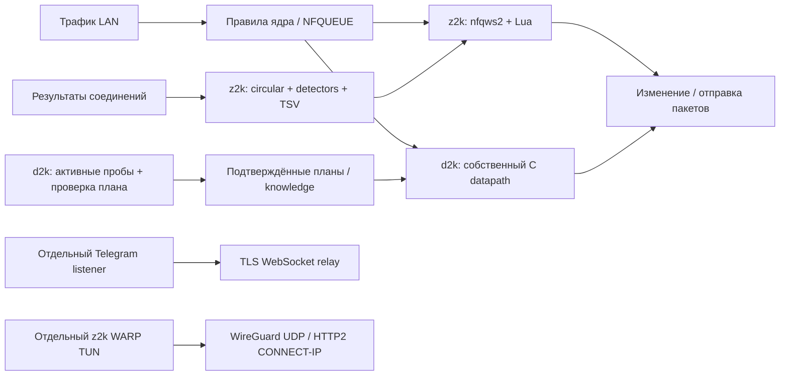

# z2k и d2k: движки и механизмы функций — 04.10.2026

Уточнённый запрос пользователя: понять, что z2k получает от NFQWS2, что добавляет сам и как работают остальные функции; дополнительно сопоставить тестовую ветку d2k `feat/telegram-tunnel`. База исследовательской ветки перед этой порцией — `1f5675e`, worktree `sol-research`. Только документы. Исходники читались как данные; upstream shell/Lua/binaries/tests, сборки, установки и сетевые пробы не запускались. Production, VM, роутер и GitHub не изменены.

## Закреплённые источники и главный результат

| Источник | Проверенная ревизия | Значение для разбора |
|---|---|---|
| [necronicle/z2k](https://github.com/necronicle/z2k/tree/7f630a9d459052b9c9c9eded06298f1b8f7f0a22) | `7f630a9d459052b9c9c9eded06298f1b8f7f0a22`, default `z2k-enhanced`, 02.10.2026 | Manager, Lua дополнения, стратегии, отдельные Go-туннели и диагностика |
| [necronicle/zapret2-z2k r3](https://github.com/necronicle/zapret2-z2k/tree/bed207a6be9705df83539b05ae28b3e13845f48a) | `v1.0.5.1-z2k-r3` → annotated tag `94170e84feb8c6de5122fbb7642fc23a865dfa64` → commit `bed207a6be9705df83539b05ae28b3e13845f48a` | Форк NFQWS2 и изменённый базовый `zapret-auto.lua` |
| [necronicle/d2k, указанная ветка](https://github.com/necronicle/d2k/tree/4732c77bb2af199cf4a917f44bdeff6c7e82ed37) | `4732c77bb2af199cf4a917f44bdeff6c7e82ed37`, `feat/telegram-tunnel`, проверено 04.10.2026 | Собственные C packet engine, controller, panel и Telegram client |

z2k строит DPI-путь вокруг **nfqws2 + базовых Lua библиотек zapret + своих Lua дополнений и генератора профилей**. WARP, Telegram и RuTracker bridge — отдельные пути с отдельными процессами. d2k использует **свой C packet engine и измеритель**; NFQUEUE — общий интерфейс ядра Linux, а не зависимость от executable NFQWS2. d2k переносит отдельные диагностические гипотезы/данные z2k и контракт Telegram relay.

| Вопрос | z2k | d2k в указанной ветке |
|---|---|---|
| Кто изменяет пакеты | Форк NFQWS2, действия Lua | Собственный `d2kd`, C/TLV plans |
| Как выбирается воздействие | Circular по готовому numbered pool и результатам соединений | Controller `d2kc`: измерения, проверка гипотез, отдельное подтверждение кандидата |
| Что сохраняется | TSV slot/mode/SNI, включая ещё не подтверждённые candidates | JSON plans/bindings с видом проверки, provenance и recheck |
| Где Telegram | Отдельный Go TCP-over-WSS client | Отдельный C TCP-over-WSS client к существующему Go relay |

У z2k GitHub releases API вернул пустой список: версия manager публикуется через tags/`UPDATES.json`, в проверенном manifest `seq=136`, `current=p-86.13`. Installer отдельно выбирает engine fork через `releases/latest`, fallback r3: [install.sh:1893–1903](https://github.com/necronicle/z2k/blob/7f630a9d459052b9c9c9eded06298f1b8f7f0a22/lib/install.sh#L1893). Pin manager сам по себе не закрепляет engine. Latest engine API на момент проверки и fallback совпали — r3. Его release metadata содержит embedded archive 4 339 325 bytes, digest `5d9bfd9d490f13d7aefc8d25269b44f6e06b1ad47be144f331df6476d33d93fe`; архив этой порции **не скачивался и не проверялся локально**.

Схема показывает альтернативные устройства проектов, не одновременное включение двух owners на один поток.

## 1. Что z2k получает от NFQWS2

NFQWS2 связывается с NFQUEUE, получает IP/TCP/UDP packet, распознаёт протоколы/hostname, собирает части handshake, ведёт состояние соединения и передаёт Lua структурированный dissect. Lua использует C helpers для raw send, reconstruction/fragmentation, binary/TLS операций и timers; результат выражается verdict PASS/MODIFY/DROP. Распознавание QUIC Initial не означает расшифровку защищённого пользовательского TLS/QUIC трафика. [Fork nfqws.c:355–399](https://github.com/necronicle/zapret2-z2k/blob/bed207a6be9705df83539b05ae28b3e13845f48a/nfq2/nfqws.c#L355), [runtime loop:444–588](https://github.com/necronicle/zapret2-z2k/blob/bed207a6be9705df83539b05ae28b3e13845f48a/nfq2/nfqws.c#L444), [Lua implementation](https://github.com/necronicle/zapret2-z2k/blob/bed207a6be9705df83539b05ae28b3e13845f48a/nfq2/lua.c).

| Слой | Получает/делает |
|---|---|
| `zapret-lib.lua` | Packet/blob/TLS helpers, rawsend/reconstruct/fragment functions |
| `zapret-antidpi.lua` | Готовые действия `fake`, split/disorder, `hostfakesplit`, `syndata`, send/drop и другие |
| `zapret-auto.lua` | Host/pool records, сигналы успеха/неудачи, `circular` и выбор `strategy=N` |
| z2k generator | Списки доменов, профили TCP/UDP, наборы numbered strategies, thresholds/capture windows и порядок вызовов |
| z2k Lua | Дополнительные failure detectors, state persistence, packet morph, TCP16/SNI maps |

Порядок active Lua: lib → antidpi → auto → alert → quic-silence → tcp16 → optional оставшийся legacy-silence → fooling-ext → range-rand → modern-core → state-persist. Последний оборачивает `circular`, поэтому порядок существенен. Старый `z2k-autocircular.lua` лежит в archive и active init его не загружает. [Init:942–1022](https://github.com/necronicle/z2k/blob/7f630a9d459052b9c9c9eded06298f1b8f7f0a22/files/S99zapret2.new#L942).

## 2. Как z2k подбирает и запоминает стратегию

**Выбор — из готового numbered pool.** Общий host record хранится как `autostate[askey][hostkey]`; `askey` задаётся `key=` либо instance. По накопленным failures в пределах `time=T` circular переходит к следующему slot. Новый поток получает текущий номер, существующий исполняет свой сохранённый номер. Это online обратная связь по соединениям, а не поиск произвольного нового packet plan.

Форк r3 связывает connection record с host record и фиксирует **generation identity** и `crec.nstrategy`. Возвращение номера 1→2→1 создаёт новое поколение, поэтому поздняя неудача старого соединения не штрафует новый slot. Packet и timer results проходят общие final/generation/quorum guards; ручной final/pin имеет приоритет. [Fork auto:77–142](https://github.com/necronicle/zapret2-z2k/blob/bed207a6be9705df83539b05ae28b3e13845f48a/lua/zapret-auto.lua#L77), [424–457](https://github.com/necronicle/zapret2-z2k/blob/bed207a6be9705df83539b05ae28b3e13845f48a/lua/zapret-auto.lua#L424).

**Совместимость с bol-van не следует из compat6.** z2k addons используют `circular_report_failure`, второй detector result (`pending/neutral/success`), per-attempt generation/slot и callbacks форка. В bol-van v1.0.5.2 этого набора semantics нет: `automate_conn_record` имеет другую форму и strategy берётся из общего host record. Некоторые проверки addons допускают тихий fallback, поэтому exit0/init и одинаковая compat version не доказывают сохранение автоподбора. [Bol-van auto:348–380](https://github.com/bol-van/zapret2/blob/6b6c63e3385fa73f8af3be4a69171e947f5a319d/lua/zapret-auto.lua#L348).

### Сигналы и их границы

| Механизм | Как принимает решение | Что этим не доказано |
|---|---|---|
| Базовый auto | Ранний RST, outgoing retransmits, thresholds TCP bytes / UDP incoming counts; quorum failures меняет slot | Конкретная причина DPI и доступность всего приложения |
| `z2k-alert` | Ограниченно собирает ранний ответ; plaintext fatal TLS alert до ServerHello, конкретные HTTP block signatures/portals — failure; обычные ошибки/redirect — neutral | Расшифровка TLS ciphertext и универсальное распознавание блокировок |
| `z2k-quic-silence` | v1/v2 handshake progress, bounded timer; bidirectional short-header traffic — success; конец capture window — neutral | Authenticated application success, media/voice PASS |
| Узкий Discord timer | Полное ACK ClientHello без ответа при правильных key/capture условий; failure через core, bounded reset/retry | Универсальное правило для любого TLS сайта |

Источники: [auto:195–370](https://github.com/necronicle/zapret2-z2k/blob/bed207a6be9705df83539b05ae28b3e13845f48a/lua/zapret-auto.lua#L195), [alert:127–207,248–339](https://github.com/necronicle/z2k/blob/7f630a9d459052b9c9c9eded06298f1b8f7f0a22/files/lua/z2k-alert.lua#L127), [quic-silence:77–150](https://github.com/necronicle/z2k/blob/7f630a9d459052b9c9c9eded06298f1b8f7f0a22/files/lua/z2k-quic-silence.lua#L77).

**Персистентность:** state-persist seed/reconcile обёртка читает TSV `key,host,strategy,ts,mode,sni`; frozen row задаёт `hrec.final`, callbacks сохраняют изменения и сверяют operator edits перед async result. Запись merge → lock → tmp → rename, debounce2s. Это кэш выбранного номера, **не реестр только доказанных рабочих стратегий**: candidate/outgoing-initial paths также записывают slot. Schema не содержит digest состава pool; перестановка стратегий при том же count может переинтерпретировать старый index — вывод из restore/schema. Lock при неподдерживаемом `wx` становится best effort; прочитанный Lua слой не реализует fsync/full crash durability. [state:104–298](https://github.com/necronicle/z2k/blob/7f630a9d459052b9c9c9eded06298f1b8f7f0a22/files/lua/z2k-state-persist.lua#L104), [463–610,680–725](https://github.com/necronicle/z2k/blob/7f630a9d459052b9c9c9eded06298f1b8f7f0a22/files/lua/z2k-state-persist.lua#L463).

**Ключи — часть semantics.** Standard key может агрегировать `nld=2`, использовать destination IP без hostname и разделять `|4`/`|6`; z2k `z2k_nohost_key` объединяет hostname-less Discord/STUN в bucket `nohost`. Результат относится к этому bucket, не автоматически к одному приложению/домену или каждому устройству. Init включает `--ipcache-hostname=1`, позволяя inference имени по IP. Эти механизмы не удовлетворяют RAZVILKA authoritative flow-name/shared-CDN contract сами по себе. [modern-core:34–61](https://github.com/necronicle/z2k/blob/7f630a9d459052b9c9c9eded06298f1b8f7f0a22/files/lua/z2k-modern-core.lua#L34), [init:1036–1047](https://github.com/necronicle/z2k/blob/7f630a9d459052b9c9c9eded06298f1b8f7f0a22/files/S99zapret2.new#L1036).

## 3. Дополнительные Lua действия z2k

| Функция | Реальный механизм |
|---|---|
| Range randomization | `repeats/seqovl/tcp_seq/tcp_ts` выбираются из range один раз на flow+instance+key; затем сохраняются в connection state, без flow — midpoint. [range-rand:57–140](https://github.com/necronicle/z2k/blob/7f630a9d459052b9c9c9eded06298f1b8f7f0a22/files/lua/z2k-range-rand.lua#L57) |
| Dynamic TTL | На fake уменьшает видимый TTL/hoplimit на1 при отсутствии explicit ttl/autottl. Место DPI не измеряет. [fooling-ext:36–57](https://github.com/necronicle/z2k/blob/7f630a9d459052b9c9c9eded06298f1b8f7f0a22/files/lua/z2k-fooling-ext.lua#L36) |
| `ipfrag3` | Три IP fragments, offsets/overlap выровнены на8 bytes, общий fragment ID; optional IPv6 next-header overrides. [modern-core:99–255](https://github.com/necronicle/z2k/blob/7f630a9d459052b9c9c9eded06298f1b8f7f0a22/files/lua/z2k-modern-core.lua#L99) |
| Timing morph | Bounded burst bad-checksum fake packets с padding/left-shift TCP sequence, optional bounded TCP drops. Имя не означает timer-based задержку реального пакета. [modern-core:536–605](https://github.com/necronicle/z2k/blob/7f630a9d459052b9c9c9eded06298f1b8f7f0a22/files/lua/z2k-modern-core.lua#L536) |
| QUIC morph | Один fragment profile на flow; мутирует version/CID/token fake с badsum, настоящий payload сохраняет и отправляет fragmented, затем обычно DROP original. `live_chance` игнорируется. [modern-core:626–730](https://github.com/necronicle/z2k/blob/7f630a9d459052b9c9c9eded06298f1b8f7f0a22/files/lua/z2k-modern-core.lua#L626) |
| TCP16/SNI | Внешний probe строит ASN/net→SNI карту; Lua клонирует настоящий ClientHello в fake с заменой SNI и вызывает `fake:optional`. Это отдельный mechanism от circular. [tcp16:14–75,146–203](https://github.com/necronicle/z2k/blob/7f630a9d459052b9c9c9eded06298f1b8f7f0a22/files/lua/z2k-tcp16.lua#L14) |

Польза каждого приёма зависит от пути/оборудования. Source limitation QUIC morph: `pcall(rawsend_dissect_ipfrag)` проверяет исключение, но не false-return перед DROP; фактическую отправку/приём fragments нужно проверить отдельно. TCP16 карта огрубляет prefixes до IPv4/16 и IPv6/32. В семи active addon Lua не найдены HTTP/socket telemetry, `os.execute`/`io.popen`; modern-core читает `/dev/urandom`, state/TCP16 делают filesystem IO с partly overrideable `/opt/zapret2`/`/tmp` defaults. Это вывод только о данном Lua subset.

## 4. Отдельные функции z2k вне NFQWS2

### WARP

`z2k-warpd` регистрирует Cloudflare account, сохраняет keys/addresses/endpoint, создаёт Linux TUN и NAT/MSS path. Два transport: vendored wireguard-go UDP и HTTP/2 CONNECT-IP. WG bind добавляет registered `client_id` reserved bytes и preamble из DNS-похожей + шести junk datagrams перед обычным WG initiation. Это не превращает WG в полноценный AWG engine. [engine:145–214](https://github.com/necronicle/z2k/blob/7f630a9d459052b9c9c9eded06298f1b8f7f0a22/z2k-warpd/internal/engine/engine.go#L145), [bind:31–77](https://github.com/necronicle/z2k/blob/7f630a9d459052b9c9c9eded06298f1b8f7f0a22/z2k-warpd/internal/transport/wg/bind.go#L31).

HTTP/2 transport: TLS/ALPN h2, CONNECT с `cf-connect-proto: cf-connect-ip`, IP в DATAGRAM capsules. Web PKI chain не проверяется, зато server ECDSA public key сравнивается с полученным при регистрации: это pin-based проверка, не отсутствие проверки и не QUIC/H3 transport. [h2.go:82–200](https://github.com/necronicle/z2k/blob/7f630a9d459052b9c9c9eded06298f1b8f7f0a22/z2k-warpd/internal/transport/h2/h2.go#L82).

Source-device/destination ipsets → masked mark → PBR table989 → TUN. `ready` требует двух разнесённых trace GET через TUN с `warp=on`; повторные checks каждые20s. Shell selfheal при ready=false снимает PBR и возвращает direct path. Для RAZVILKA такая fallback policy должна отдельно совпадать с пользовательским выбором. [warp routing:440–501](https://github.com/necronicle/z2k/blob/7f630a9d459052b9c9c9eded06298f1b8f7f0a22/files/z2k-warp.sh#L440), [health:191–225](https://github.com/necronicle/z2k/blob/7f630a9d459052b9c9c9eded06298f1b8f7f0a22/z2k-warpd/internal/health/health.go#L191), [selfheal:945–973](https://github.com/necronicle/z2k/blob/7f630a9d459052b9c9c9eded06298f1b8f7f0a22/files/z2k-warp.sh#L945).

Domain routes изучаются по пассивным NFLOG-копиям обычных DNS responses: A/CNAME → client/IP sets, minimum chain TTL capped1h, bounded clients/pairs. AAAA/DoH/DoT/старый DNS cache не покрываются; shared IP затрагивает другой сайт того же клиента. Ответ DNS не удерживается до publication маршрута, поэтому возможна гонка первого соединения. [DNS parser](https://github.com/necronicle/z2k/blob/7f630a9d459052b9c9c9eded06298f1b8f7f0a22/z2k-warpd/internal/domainroute/dns.go#L47), [cache bounds](https://github.com/necronicle/z2k/blob/7f630a9d459052b9c9c9eded06298f1b8f7f0a22/z2k-warpd/internal/domainroute/cache.go#L8).

### Telegram и RuTracker bridge

`mtproxy-client` — прозрачный **TCP-over-WSS multiplexer**. Telegram DC IPv4 CIDRs/TCP443 REDIRECT на listener1443; `SO_ORIGINAL_DST` даёт исходный target; CONNECT/DATA/WINDOW идут через одну TLS WebSocket сессию к внешнему relay, который открывает TCP к target. MTProto клиент не разбирает. Ed25519 per-install identity и HMAC enrollment дают AUTHID v2 с relay nonce/time; reconnect и queues/window ограничены. [tunnel/auth:436–566](https://github.com/necronicle/z2k/blob/7f630a9d459052b9c9c9eded06298f1b8f7f0a22/mtproxy-client/tunnel.go#L436), [stream flow:920–1028](https://github.com/necronicle/z2k/blob/7f630a9d459052b9c9c9eded06298f1b8f7f0a22/mtproxy-client/tunnel.go#L920).

В этом pin actual destination parser IPv4-only; Telegram IPv6 DC TCP REJECT применяется для fallback клиента на IPv4. UDP relay experiment retired; active UDP tunnel нет. Дополнительный listener1444 обслуживает отдельный cdnbase TCP80. Это отдельная инфраструктура, не автономный NFQWS обход. [listener:38–81](https://github.com/necronicle/z2k/blob/7f630a9d459052b9c9c9eded06298f1b8f7f0a22/mtproxy-client/listener.go#L38), [v6/retired UDP helper](https://github.com/necronicle/z2k/blob/7f630a9d459052b9c9c9eded06298f1b8f7f0a22/files/z2k-tg-redirect.sh#L167).

RuTracker bridge — другой Go process: пять pinned DNS names → sentinel IP → REDIRECT443 → SNI peek без завершения клиентского TLS → HTTPS CONNECT через внешний proxy pool → replay ClientHello. Inner TLS остаётся между браузером и сайтом. Health проверяет CONNECT/inner TLS/8192 body bytes, но при отказе всех body checks явно допускает handshake-only pool. Outer proxy TLS certificate verification отключена; diagnostic inner pin optional. [bridge:917–976](https://github.com/necronicle/z2k/blob/7f630a9d459052b9c9c9eded06298f1b8f7f0a22/rt-proxy/main.go#L917), [degraded pool:348–388](https://github.com/necronicle/z2k/blob/7f630a9d459052b9c9c9eded06298f1b8f7f0a22/rt-proxy/main.go#L348), [outer TLS:589–607](https://github.com/necronicle/z2k/blob/7f630a9d459052b9c9c9eded06298f1b8f7f0a22/rt-proxy/main.go#L589).

### Диагностика и TCP16

`z2k-detect probe`: DNS → racing TCP443 (до3 IP) → TLS с целевым SNI → HTTP GET body до32KiB; TLS1.2 fallback/нейтральный SNI к тому же IP помогают различать наблюдаемые отказы. Выход `ignore/watch/hot` и tri-state HTTP — классификация симптома; server policy/outage не исключены. Certificate identity намеренно не проверяется. Probe sockets получают bypass mark, но ошибки установки exclusion rule игнорируются: «direct works» требует отдельного proof, что probe действительно миновал работающий NFQWS. [prober:105–247,356–468](https://github.com/necronicle/z2k/blob/7f630a9d459052b9c9c9eded06298f1b8f7f0a22/z2k-detect/internal/prober/prober.go#L105), [bypass:17–62](https://github.com/necronicle/z2k/blob/7f630a9d459052b9c9c9eded06298f1b8f7f0a22/z2k-detect/internal/prober/raw_linux.go#L17).

TCP16 probe отправляет10 keep-alive HEAD по одному соединению, после первого — random X-Pad4000; failure после приблизительных padded12KiB даёт suspected cutoff. SNI scan ищет имя, при котором контрольный target отвечает дольше. Это не точный счётчик TLS wire bytes и не исключение server header/rate/keepalive limits. Измеритель строит карту, а `z2k-tcp16.lua` только использует её. [TCP16:101–202](https://github.com/necronicle/z2k/blob/7f630a9d459052b9c9c9eded06298f1b8f7f0a22/z2k-detect/internal/tcp16/tcp16.go#L101).

### Meta DNS, проверка резолверов и PPE

У z2k собственный Meta helper `z2k-insta-ip-refresh.sh`:12 fixed Instagram/WhatsApp names → relay HTTPS `/resolve` на443 с отдельным HMAC `X-Z2K-Auth` → IPv4 candidates → range filter → curl HTTPS с настоящим host/SNI и pinned IP → NDM `ip host`. Resolve secret имеет public default/config override, поэтому HMAC этого request не доказывает private per-install identity. Defaults:3s probe, первые8 candidates, max4 tries/2 accepted IP. Probe принимает HTTP code≠000; exit code curl/full body не являются gate. Для c10r используется `-k` при наличии Meta range file. При полном отсутствии range files адреса применяются без membership check; `Z2K_IP_PROBE=0` отключает probe. Ни один accepted IP не означает успешный вход в приложение. [Endpoint/auth:44–105](https://github.com/necronicle/z2k/blob/7f630a9d459052b9c9c9eded06298f1b8f7f0a22/files/z2k-insta-ip-refresh.sh#L44), [request:174–190](https://github.com/necronicle/z2k/blob/7f630a9d459052b9c9c9eded06298f1b8f7f0a22/files/z2k-insta-ip-refresh.sh#L174), [ranges:237–302](https://github.com/necronicle/z2k/blob/7f630a9d459052b9c9c9eded06298f1b8f7f0a22/files/z2k-insta-ip-refresh.sh#L237), [probe:324–374](https://github.com/necronicle/z2k/blob/7f630a9d459052b9c9c9eded06298f1b8f7f0a22/files/z2k-insta-ip-refresh.sh#L324).

Здесь нет exact owner manifest d2k: если найдены новые candidates, refresher сначала удаляет **все** старые NDM пары exact hostname, затем добавляет новые, без восстановления при add failure; conntrack удаляется по старому IP без точного flow owner. Explicit `Z2K_INSTA_DNS=0`/refresh=0 запрещают восстановление, пустой список NDM сам по себе не opt-out. Menu удаления затрагивает все Instagram/cdninstagram suffix pairs и записывает DNS=0; флаг также выключает refresh WhatsApp hosts. В d2k перенос pipeline сопровождается отдельным C `/resolve` на9443, mandatory range list, TLS-edge probe с neutral SNI и manifest-before-add; критерии и ownership semantics этих helper нельзя считать одинаковыми. [Apply:362–421](https://github.com/necronicle/z2k/blob/7f630a9d459052b9c9c9eded06298f1b8f7f0a22/files/z2k-insta-ip-refresh.sh#L362), [opt-out:119–158](https://github.com/necronicle/z2k/blob/7f630a9d459052b9c9c9eded06298f1b8f7f0a22/files/z2k-insta-ip-refresh.sh#L119), [menu:305–358](https://github.com/necronicle/z2k/blob/7f630a9d459052b9c9c9eded06298f1b8f7f0a22/lib/menu.sh#L305).

Installer добавляет7 static Instagram fallback pairs, если основной записи нет и функция не выключена флагом; затем запускает refresh в фоне. Nightly list updater, вызываемый scheduler в04:00, обновляет candidates после jitter0–60min и своей list работы. `S99zapret2.new` сам Meta refresh не вызывает. [Fallback:3698–3721](https://github.com/necronicle/z2k/blob/7f630a9d459052b9c9c9eded06298f1b8f7f0a22/lib/install.sh#L3698), [gate:3886–3928](https://github.com/necronicle/z2k/blob/7f630a9d459052b9c9c9eded06298f1b8f7f0a22/lib/install.sh#L3886), [background:4438–4452](https://github.com/necronicle/z2k/blob/7f630a9d459052b9c9c9eded06298f1b8f7f0a22/lib/install.sh#L4438), [nightly:951–991](https://github.com/necronicle/z2k/blob/7f630a9d459052b9c9c9eded06298f1b8f7f0a22/files/z2k-update-lists.sh#L951).

`z2k-dns-check.sh` — отдельная диагностика UDP53/DoH/DoT, которая пишет JSON в `/tmp`. Heuristics: повтор одного IP для разных targets, ответ TEST-NET canary, сравнение с ≥2 DoH votes и общий /24 у двух proxy targets. Метки works/spoof/silent/proxy — вывод по набору targets, не криптографическая гарантия правдивости произвольного DNS. DoT `s_client` использует SNI, но не задаёт `verify_hostname/verify_return_error`; ссылка на «шифрованный путь» сама по себе не доказывает аутентификацию. NDM resolver configuration этот скрипт не меняет. [DoT:306–331](https://github.com/necronicle/z2k/blob/7f630a9d459052b9c9c9eded06298f1b8f7f0a22/files/z2k-dns-check.sh#L306), [reference/proxy:350–385](https://github.com/necronicle/z2k/blob/7f630a9d459052b9c9c9eded06298f1b8f7f0a22/files/z2k-dns-check.sh#L350), [classify/output:589–695](https://github.com/necronicle/z2k/blob/7f630a9d459052b9c9c9eded06298f1b8f7f0a22/files/z2k-dns-check.sh#L589).

PPE helper задуман вернуть NFQWS2 видимость первых пакетов, которые иначе может скрыть аппаратный fast path: mangle PREROUTING/FORWARD → TCP dports80,443,2053,2083,2087,2096,5222,8443 и UDP443 → firmware `PPE`, `connskip=30` default. Сам helper не выключает PPE глобально, но selector не проверяет hostname/device/nozapret и затрагивает все совпавшие flows. Target availability проверяется через `/proc`; ensure success проверяет наличие только TCPv4 rules, UDP/v6 best effort. Это наличие правил, не измеренная packet visibility/rotation/throughput. Правила применяет init и reassert после NDM regeneration/scheduler tick; scheduler использует общий pidof nfqws2. [Selectors:61–65,132–148](https://github.com/necronicle/z2k/blob/7f630a9d459052b9c9c9eded06298f1b8f7f0a22/files/z2k-ppe-deoffload.sh#L61), [availability:113–129](https://github.com/necronicle/z2k/blob/7f630a9d459052b9c9c9eded06298f1b8f7f0a22/files/z2k-ppe-deoffload.sh#L113), [ensure:153–175](https://github.com/necronicle/z2k/blob/7f630a9d459052b9c9c9eded06298f1b8f7f0a22/files/z2k-ppe-deoffload.sh#L153), [init:2578–2584](https://github.com/necronicle/z2k/blob/7f630a9d459052b9c9c9eded06298f1b8f7f0a22/files/S99zapret2.new#L2578), [scheduler:455–477](https://github.com/necronicle/z2k/blob/7f630a9d459052b9c9c9eded06298f1b8f7f0a22/files/z2k-scheduler.sh#L455).

### Webpanel, scheduler, telemetry и updates

Webpanel — CGI dispatcher общих shell-функций; долгие операции дают job_id и `/tmp` pid/log/exit, frontend опрашивает результат. Есть origin/Host gate и optional Keenetic-password session; auth не отсутствует, но opt-in password и HTTP session не равны RAZVILKA auth/TLS contract. Whitelist edit использует SHA256 CAS + lock + candidate validation + rename. GET update/status может скачать manifest и записать cache; display cache не signature proof, apply отдельно проверяет подпись. [API gates](https://github.com/necronicle/z2k/blob/7f630a9d459052b9c9c9eded06298f1b8f7f0a22/webpanel/cgi/api.sh#L227), [job launcher](https://github.com/necronicle/z2k/blob/7f630a9d459052b9c9c9eded06298f1b8f7f0a22/webpanel/cgi/actions.sh#L1031), [CAS edit](https://github.com/necronicle/z2k/blob/7f630a9d459052b9c9c9eded06298f1b8f7f0a22/webpanel/cgi/actions.sh#L4105), [GET update status](https://github.com/necronicle/z2k/blob/7f630a9d459052b9c9c9eded06298f1b8f7f0a22/webpanel/cgi/api.sh#L1521).

Scheduler — shell loop tick30s; daily markers на flash, частые markers в RAM. Default update02:00, stats03:00, TCP16 03:30, lists04:00; watchdogs восстанавливают службы/правила. Marker записывается до запуска task: это launch dedup, не durable success/retry journal. [Scheduler:348–517](https://github.com/necronicle/z2k/blob/7f630a9d459052b9c9c9eded06298f1b8f7f0a22/files/z2k-scheduler.sh#L348).

Stats берёт pool/slot/dwell buckets из TSV без hostname/device ID. Default enabled; уведомление ACK gate ждёт максимум3 суток, это не opt-in. Default endpoint HTTP; сервер видит сетевой source IP независимо от отсутствия поля в payload. [Stats:47–141](https://github.com/necronicle/z2k/blob/7f630a9d459052b9c9c9eded06298f1b8f7f0a22/files/z2k-stats-upload.sh#L47).

Updater использует file hashes, immutable ref, Ed25519 и trust ratchet. До первой валидной подписи допускает legacy unsigned/unverifiable путь; после pin отказывает. `seq` есть в manifest, но проверенный updater/verifier не сохраняет monotonic maximum: подпись не доказывает freshness. Rollback snapshot хранит config/init/selected strategies/state и при наличии места binaries, но не полный неизменяемый Lua/asset generation. [Trust:104–284](https://github.com/necronicle/z2k/blob/7f630a9d459052b9c9c9eded06298f1b8f7f0a22/lib/auto_update.sh#L104), [reinstall ref:1924–1973](https://github.com/necronicle/z2k/blob/7f630a9d459052b9c9c9eded06298f1b8f7f0a22/lib/auto_update.sh#L1924), [snapshot:4841–4889](https://github.com/necronicle/z2k/blob/7f630a9d459052b9c9c9eded06298f1b8f7f0a22/lib/install.sh#L4841).

## 5. Собственный packet engine, измерения и память d2k

### NFQUEUE, controller и планы

`d2kd` собирает собственные TLS/QUIC parser, session state, packet generation, plan execution, NFQUEUE и raw sockets. NFQUEUE обслуживается прямым Linux netlink. Lua и executable nfqws2 в этой runtime цепочке не участвуют. Discord signature ссылается на донорский `nfq2/protocol.c`; это заимствование распознавания, а не запуск NFQWS2. [Datapath Makefile:15–40](https://github.com/necronicle/d2k/blob/4732c77bb2af199cf4a917f44bdeff6c7e82ed37/datapath/Makefile#L15), [nfq.c:8–20](https://github.com/necronicle/d2k/blob/4732c77bb2af199cf4a917f44bdeff6c7e82ed37/datapath/nfq.c#L8), [signature:361–387](https://github.com/necronicle/d2k/blob/4732c77bb2af199cf4a917f44bdeff6c7e82ed37/datapath/session.c#L361).

`d2kc` измеряет путь, получает текст стратегии, переводит его в canonical TLV и передаёт `d2kd` через AF_UNIX. Исполнитель поддерживает fake, split/disorder/overlap, TTL/checksum/sequence modifiers, delay, IP fragments, UDP padding и QUIC CRYPTO split. TLV schema=1, execution version=10, control protocol=9; старый комментарий controller про version4 не является действующим контрактом. [Plan schema](https://github.com/necronicle/d2k/blob/4732c77bb2af199cf4a917f44bdeff6c7e82ed37/datapath/include/d2k_plan.h#L1), [control protocol](https://github.com/necronicle/d2k/blob/4732c77bb2af199cf4a917f44bdeff6c7e82ed37/datapath/include/d2k_ctl.h#L44), [greeting check:209–225](https://github.com/necronicle/d2k/blob/4732c77bb2af199cf4a917f44bdeff6c7e82ed37/core/d2kc.c#L209).

### Как находится и подтверждается воздействие

TCP search — C-перенос диагностических гипотез z2k; active hooks ведут в `detect/bridge.c`, не legacy `core/verdict.c`. Измерения baseline → split после первого байта → нейтральный контроль → poison hypotheses → длинная пауза/reassembly → binary search границы сокращают пространство кандидатов. Смешанные повторы дают `FLAKY`, отсутствие нормальной контрольной базы — `INCONCLUSIVE`. README «не bruteforce» означает структурированный поиск, а не отсутствие перебора гипотез. [Active hooks:240–259](https://github.com/necronicle/d2k/blob/4732c77bb2af199cf4a917f44bdeff6c7e82ed37/core/d2kc.c#L240), [classify:931–1107](https://github.com/necronicle/d2k/blob/4732c77bb2af199cf4a917f44bdeff6c7e82ed37/detect/classify.c#L931).

| Этап / протокол | Принимаемое доказательство | Граница результата |
|---|---|---|
| TCP replay oracle | Разобранный ServerHello в ответ на копию клиентского ClientHello | Чужое TLS рукопожатие не завершается без private key; это дешёвый oracle, не HTTP success |
| TCP final verifier | Собственная TLS/HTTP сессия с полностью полученным HTTP-ответом; для non-HTTP ALPN допустим отдельный `PROBE_HANDSHAKE` | Handshake сохраняется отдельным видом доказательства, ниже APPLICATION |
| Execution receipt | Fresh trial identity + matching flow; `APPLIED` только после `PLAN_DONE`, всех отправок без ошибки и совпавшего execution token | Установка/подготовка `PLAN_APPLIED` не равна полному исполнению; без matching receipt успешный verifier не публикует candidate |
| QUIC final verifier | Свежий UDP tuple, настоящая QUIC/HTTP3 сессия, status≠451 и gapless ответ до FIN либо ≥32768 distinct response bytes | Порог измерения не доказывает завершение произвольного большого download |
| Discord/STUN voice | После matching APPLIED: Discovery response с совпавшим SSRC либо STUN Binding Success с совпавшим transaction ID | Любой другой обратный UDP — `EXCHANGE/NONE`; protocol response не подтверждает аудио/звонок |

Источники: [replay contract](https://github.com/necronicle/d2k/blob/4732c77bb2af199cf4a917f44bdeff6c7e82ed37/core/include/d2k_meas.h#L24), [own verifier](https://github.com/necronicle/d2k/blob/4732c77bb2af199cf4a917f44bdeff6c7e82ed37/core/verify.c#L1), [non-HTTP gate](https://github.com/necronicle/d2k/blob/4732c77bb2af199cf4a917f44bdeff6c7e82ed37/core/sched.c#L7997), [trial identity:3074–3089](https://github.com/necronicle/d2k/blob/4732c77bb2af199cf4a917f44bdeff6c7e82ed37/core/sched.c#L3074), [wait/promotion:8094–8168](https://github.com/necronicle/d2k/blob/4732c77bb2af199cf4a917f44bdeff6c7e82ed37/core/sched.c#L8094), [prepared vs done:490–505](https://github.com/necronicle/d2k/blob/4732c77bb2af199cf4a917f44bdeff6c7e82ed37/datapath/ctlsrv.c#L490), [send completion:2628–2647](https://github.com/necronicle/d2k/blob/4732c77bb2af199cf4a917f44bdeff6c7e82ed37/datapath/session.c#L2628), [QUIC data judge:401–455](https://github.com/necronicle/d2k/blob/4732c77bb2af199cf4a917f44bdeff6c7e82ed37/core/include/d2k_quicprobe.h#L401), [voice proof:726–755](https://github.com/necronicle/d2k/blob/4732c77bb2af199cf4a917f44bdeff6c7e82ed37/datapath/session.c#L726).

QUIC имеет своё дерево Initial-response/control/residual-blocking измерений: direct passage требует3/3, control хотя бы один ответ; финальная проверка выполняется отдельно. Voice trial сначала ограничен следующим потоком того же LAN-клиента к тому же server IP:port, с lease identity и любым новым client port. После receipt controller ждёт protocol proof конкретного flow; только тогда переносит plan в постоянную binding. [QUIC search:2500–2635](https://github.com/necronicle/d2k/blob/4732c77bb2af199cf4a917f44bdeff6c7e82ed37/core/quicprobe.c#L2500), [voice lease:5063–5147](https://github.com/necronicle/d2k/blob/4732c77bb2af199cf4a917f44bdeff6c7e82ed37/core/sched.c#L5063), [promotion:5550–5625](https://github.com/necronicle/d2k/blob/4732c77bb2af199cf4a917f44bdeff6c7e82ed37/core/sched.c#L5550).

### Что запоминается и на какие следующие потоки переносится

JSON schema1 хранит сами plans/boxes/bindings, verification kind, input `CLIENT/PROFILE/TRANSFER`, timestamps и recheck. `d2kd` не сохраняет wire state между рестартами: controller загружает каталог и синхронизирует его снова. Запись `.new`→rename не содержит fsync в просмотренной цепочке. Один независимый direct CLEAR снимает соответствующую форму с провода и помечает recheck; второй CLEAR удаляет binding, новое подтверждение восстанавливает её. Старые shape0 records сохраняют более широкую совместимость. [Save:87–114](https://github.com/necronicle/d2k/blob/4732c77bb2af199cf4a917f44bdeff6c7e82ed37/core/d2kc.c#L87), [startup sync:261–265](https://github.com/necronicle/d2k/blob/4732c77bb2af199cf4a917f44bdeff6c7e82ed37/core/d2kc.c#L261), [catalog restore:1098–1111](https://github.com/necronicle/d2k/blob/4732c77bb2af199cf4a917f44bdeff6c7e82ed37/core/catalog.c#L1098), [CLEAR policy:3482–3557](https://github.com/necronicle/d2k/blob/4732c77bb2af199cf4a917f44bdeff6c7e82ed37/core/sched.c#L3482).

Named binding — exact hostname + transport + IP family + hello shape. Address binding — IP + family + shape, без permanent server port. Discord voice promotion переходит к ярлыку `@discord-voice`: перенос одного протокольного опыта на класс, не proof каждого endpoint. STUN permanence ограничена IP/IPv4; voice class выделяется строгой Discovery signature либо STUN на50000–50099, иной STUN идёт address path. [Binding schema:171–205](https://github.com/necronicle/d2k/blob/4732c77bb2af199cf4a917f44bdeff6c7e82ed37/core/include/d2k_catalog.h#L171), [address command](https://github.com/necronicle/d2k/blob/4732c77bb2af199cf4a917f44bdeff6c7e82ed37/datapath/include/d2k_ctl.h#L52), [class selection:824–843](https://github.com/necronicle/d2k/blob/4732c77bb2af199cf4a917f44bdeff6c7e82ed37/datapath/session.c#L824).

Domain-family перенос сильнее простого `nld=2`: PSL с wildcard/exception rules, reject public suffix/unknown TLD, context transport/family/shape/probe-path/ECH-origin. Первичная группа требует3 distinct subdomain votes одного Plan ID, затем возможны2 live против1 stale. Exact binding имеет приоритет; DIRECT_CLEAR/PLAN_FAILED дают contextual exclusions, lookup использует longest suffix. Это эвристика переноса на непроверенные siblings, не authoritative имя текущего LAN flow. [PSL:6–71](https://github.com/necronicle/d2k/blob/4732c77bb2af199cf4a917f44bdeff6c7e82ed37/core/domain.c#L6), [votes:8–57](https://github.com/necronicle/d2k/blob/4732c77bb2af199cf4a917f44bdeff6c7e82ed37/core/groups.c#L8), [exceptions:272–290](https://github.com/necronicle/d2k/blob/4732c77bb2af199cf4a917f44bdeff6c7e82ed37/core/groups.c#L272), [lookup:1031–1098](https://github.com/necronicle/d2k/blob/4732c77bb2af199cf4a917f44bdeff6c7e82ed37/datapath/plans.c#L1031).

Ёмкости64 groups/256 observations. Negative evidence не вытесняется; невозможность записать exclusion отключает derived families, сохраняя exact bindings. `30-day TTL` используется при reclaim заполненного observation journal, не при votes/rebuild: автоматическое истечение всех family plans через30 суток из этого кода не следует. [Capacities](https://github.com/necronicle/d2k/blob/4732c77bb2af199cf4a917f44bdeff6c7e82ed37/core/include/d2k_groups.h#L5), [bounded evidence:133–200](https://github.com/necronicle/d2k/blob/4732c77bb2af199cf4a917f44bdeff6c7e82ed37/core/groups.c#L133).

**Границы доказательства:** обычный final verifier не удостоверяет подлинность сервера; SAN mismatch диагностический, HTTP403 может пройти APPLICATION, полный cross-host redirect подтверждает получение redirect без посещения цели. ECH path отдельно требует известного origin witness/accepted ECH/name match и APPLICATION с полным телом ответа (`body_complete`); скрытый клиентский SNI не извлекается. Успех own QUIC probe ещё не гарантирует применимость split к client multi-datagram ClientHello. [Verifier boundary:20–24,812–850](https://github.com/necronicle/d2k/blob/4732c77bb2af199cf4a917f44bdeff6c7e82ed37/core/verify.c#L20), [ECH/client shape:6253–6307](https://github.com/necronicle/d2k/blob/4732c77bb2af199cf4a917f44bdeff6c7e82ed37/core/sched.c#L6253).

Greeting9 проверяет совместимость AF_UNIX peer, не его личность. В просмотренном `d2kd/ctlsrv/ctl` explicit SO_PEERCRED/chmod/umask/chown gate не найден; доступ зависит от inherited permissions окружения. Первый peer принимается, второй отвергается. Нельзя утверждать, что application receipt и local controller identity одновременно доказаны только данным greeting. [Socket setup/accept:81–176](https://github.com/necronicle/d2k/blob/4732c77bb2af199cf4a917f44bdeff6c7e82ed37/datapath/ctl.c#L81), [runtime accept:1129–1138](https://github.com/necronicle/d2k/blob/4732c77bb2af199cf4a917f44bdeff6c7e82ed37/datapath/d2kd.c#L1129).

## 6. Telegram в d2k: перенос контракта в C

`d2ktg` — отдельный C process, независимый от d2kd/NFQUEUE. Перехват Telegram IPv4 TCP443 → listener1443 → SO_ORIGINAL_DST → TLS-verified WebSocket к существующему внешнему **Go relay z2k**. Клиентский multiplexer переписан на C; relay не мигрирует на C и не становится функцией NFQWS2. Wire сохраняет CONNECT/DATA/CLOSE/WINDOW; poll loop обслуживает bounded stream queues и negotiated credit. [listener:8–31](https://github.com/necronicle/d2k/blob/4732c77bb2af199cf4a917f44bdeff6c7e82ed37/telegram/src/listener.c#L8), [wire:22–49](https://github.com/necronicle/d2k/blob/4732c77bb2af199cf4a917f44bdeff6c7e82ed37/telegram/src/wire.c#L22), [tunnel:180–240](https://github.com/necronicle/d2k/blob/4732c77bb2af199cf4a917f44bdeff6c7e82ed37/telegram/src/tunnel.c#L180).

TLS использует CA bundle, chain verification и hostname/IP verification, minimum TLS1.2. Session HELLO/HELLO_ACK сообщает clock offset/nonce/window; AUTHID подписывает installID+corrected timestamp+nonce Ed25519; v1 fallback допускается по protocol-version rejection, не после auth rejection. Reconnect имеет jitter/backoff/read expiry/ping, repeated fast deaths вызывают повторную регистрацию. [tls.c:8–45](https://github.com/necronicle/d2k/blob/4732c77bb2af199cf4a917f44bdeff6c7e82ed37/telegram/src/tls.c#L8), [session.c:40–106](https://github.com/necronicle/d2k/blob/4732c77bb2af199cf4a917f44bdeff6c7e82ed37/telegram/src/session.c#L40).

В этой ветке без shared secret регистрация идёт через C enrollment HTTPS `/register` с proof собственного ключа; legacy secret mode использует HMAC JSON регистрацию. При explicit ID conflict клиент удаляет local identity и mint заново; это отдельный lifecycle effect, который нельзя автоматически отождествить с RAZVILKA unknown enrollment recovery. [register.c:35–84](https://github.com/necronicle/d2k/blob/4732c77bb2af199cf4a917f44bdeff6c7e82ed37/telegram/src/register.c#L35), [main.c:81–93](https://github.com/necronicle/d2k/blob/4732c77bb2af199cf4a917f44bdeff6c7e82ed37/telegram/src/main.c#L81).

Actual listener/relay connection IPv4; Telegram IPv6 TCP принудительно fast-fail через `REJECT tcp-reset`, IPv6 и UDP/QUIC не туннелируются. General d2k datapath IPv6 support не означает IPv6 Telegram tunnel. Adjacent z2k cdnbase listener1444 не входит в этот port. [Main listener/relay:49–73](https://github.com/necronicle/d2k/blob/4732c77bb2af199cf4a917f44bdeff6c7e82ed37/telegram/src/main.c#L49), [firewall:15–32](https://github.com/necronicle/d2k/blob/4732c77bb2af199cf4a917f44bdeff6c7e82ed37/files/d2k-tg-firewall.sh#L15).

## 7. Панель и DNS d2k

### Панель и состояние процессов

Current router backend — отдельный C `d2kpanel`, не старый Go `internal/web`. Служба запускает engine/controller, panel, Telegram и DNS scheduler как отдельные компоненты; `engine-stop` оставляет панель доступной. Default bind127.0.0.1:8090, authentication отсутствует; operator LAN bind открывает тот же control API. POST требует HTTP Origin==Host, HTTPS Origin не принимается: это проверка происхождения, не личности. [Service:846–869,979–1001](https://github.com/necronicle/d2k/blob/4732c77bb2af199cf4a917f44bdeff6c7e82ed37/files/S99d2k#L846), [auth/bind:268–305](https://github.com/necronicle/d2k/blob/4732c77bb2af199cf4a917f44bdeff6c7e82ed37/panel/main.c#L268), [Origin:289–298](https://github.com/necronicle/d2k/blob/4732c77bb2af199cf4a917f44bdeff6c7e82ed37/panel/server.c#L289).

Шесть constant actions: engine start/stop/restart, reapply, Telegram enable/disable. POST без body, `execl` фиксированного service action без shell eval; одновременно один worker, HTTP202 при приёме/409 при конфликте. После60s — TERM, через1s KILL собственной process group; job result живёт в RAM. GET обслуживает status/fixed assets. Controller live обновляется каждые2s, panel считает linked только при freshness≤15s, live не старше engine pidfile и живых engine/controller PID. При разрыве control peer controller завершает цикл. Это progress/freshness, не durable Stop authority и не exact PID identity. [Actions:392–462](https://github.com/necronicle/d2k/blob/4732c77bb2af199cf4a917f44bdeff6c7e82ed37/panel/server.c#L392), [worker:301–345](https://github.com/necronicle/d2k/blob/4732c77bb2af199cf4a917f44bdeff6c7e82ed37/panel/server.c#L301), [freshness:665–690](https://github.com/necronicle/d2k/blob/4732c77bb2af199cf4a917f44bdeff6c7e82ed37/panel/server.c#L665), [disconnect:365–377](https://github.com/necronicle/d2k/blob/4732c77bb2af199cf4a917f44bdeff6c7e82ed37/core/d2kc.c#L365).

### Meta DNS: candidates, TLS edge check, owned NDM pins

Helper не занимается произвольным DNS: fixed18 Instagram/FB CDN/WhatsApp names → HTTPS POST `/resolve` на внешний service → A/IPv4 candidates → static Meta CIDR allowlist → TLS probe с роутера. Для имени — первые8 parsed IP, не более4 подходящих по диапазону probes, до2 успешных pins. При нехватке заново проверяет family candidates из fresh results/manifest; Instagram family требует успех `instagram.com`, WhatsApp/fbcdn независимы. [Resolve/probes:178–244](https://github.com/necronicle/d2k/blob/4732c77bb2af199cf4a917f44bdeff6c7e82ed37/files/d2k-instagram-dns.sh#L178), [family:251–305](https://github.com/necronicle/d2k/blob/4732c77bb2af199cf4a917f44bdeff6c7e82ed37/files/d2k-instagram-dns.sh#L251).

Сервер `/resolve` реализован в C `relay-enroll/main.c`: public endpoint с exact18-host allowlist, ≤32 input names/2048-byte body, source/global request limits и bounded worker pools. Он объединяет IPv4 `getaddrinfo` VPS и параллельные UDP53 ответы1.1.1.1/8.8.8.8/9.9.9.9, до8 distinct IP на имя; DNS parser сверяет ID/question/flags/CNAME chain, DNSSEC нет. Непустые ответы кешируются в shared mmap на fixed600s по monotonic clock, RR TTL не используется; empty results не кешируются. `/register` имеет отдельный proof/auth path. Это подтверждает наличие source implementation, не развёртывание exact commit на публичном VPS и не доступность IP с данного роутера. [Input/limits:33–91,498–519](https://github.com/necronicle/d2k/blob/4732c77bb2af199cf4a917f44bdeff6c7e82ed37/relay-enroll/main.c#L33), [DNS checks:318–403](https://github.com/necronicle/d2k/blob/4732c77bb2af199cf4a917f44bdeff6c7e82ed37/relay-enroll/main.c#L318), [cache/parallel/union:416–550](https://github.com/necronicle/d2k/blob/4732c77bb2af199cf4a917f44bdeff6c7e82ed37/relay-enroll/main.c#L416), [route/auth:614–653](https://github.com/necronicle/d2k/blob/4732c77bb2af199cf4a917f44bdeff6c7e82ed37/relay-enroll/main.c#L614).

`d2ktg --check-instagram-ip` соединяется с IP443, deadline5s, wire SNI `example.com`, но сертификат проверяет для требуемого Meta имени (`instagram.c10r.instagram.com` — canonical instagram.com). HTTP запроса нет. Это reachable TLS edge+certificate, не APPLICATION/DPI verdict и не proof работы настоящего клиента с настоящим SNI. [Probe:182–223](https://github.com/necronicle/d2k/blob/4732c77bb2af199cf4a917f44bdeff6c7e82ed37/telegram/src/main.c#L182).

Owned manifest — exact `(host,ip)`. Требует успешного непустого NDM read; ошибка не становится «записей нет». Существующая пара не присваивается без прежнего claim. Новая отсутствующая пара сначала получает claim, затем NDM add. Плохие pins очищаются отдельным `drop_dead_pins` до additions; остальные прежние owned pins снимаются после публикации свежего адреса host и сохраняются при add failure. Remove ограничен manifest pairs; при read/remove/save errors manifest сохраняется. Если VPS недоступен, но другой owned pin подтвердил uplink, возможна очистка плохих pins; если все пробы отказали, предполагается общий outage и pins сохраняются. [Read/ownership:71–117](https://github.com/necronicle/d2k/blob/4732c77bb2af199cf4a917f44bdeff6c7e82ed37/files/d2k-instagram-dns.sh#L71), [remove:151–174](https://github.com/necronicle/d2k/blob/4732c77bb2af199cf4a917f44bdeff6c7e82ed37/files/d2k-instagram-dns.sh#L151), [failure:214–224](https://github.com/necronicle/d2k/blob/4732c77bb2af199cf4a917f44bdeff6c7e82ed37/files/d2k-instagram-dns.sh#L214), [claim/publish:306–395](https://github.com/necronicle/d2k/blob/4732c77bb2af199cf4a917f44bdeff6c7e82ed37/files/d2k-instagram-dns.sh#L306).

Scheduler tick60s, router local daily window01:00–04:59 со stable offset0–239min и HHMM override; без recorded success запускает сразу. Attempt заранее помечается failed, success — после helper completion. Retry30min→1h→2h…≤сутки; success date/epoch сохраняются, failures/attempt RAM сбрасываются при reboot. Stop отменяет helper и ждёт его завершения. [Scheduler:14–93,100–153](https://github.com/necronicle/d2k/blob/4732c77bb2af199cf4a917f44bdeff6c7e82ed37/files/d2k-instagram-dns-scheduler.sh#L14).

Helper не содержит interprocess lock; NDM пара не имеет owner token, внешний identical replacement неотличим. Manifest+NDM+flash не одна транзакция. Static CIDR и GeoDNS candidates ограничивают полноту. Firewall cleanup scoped к D2K chains/exact rules и heal lock, но namespace не доказывает instance identity; PID stop не сверяет executable/start time, fastnat saved-value restore меняет общий sysctl. Telegram startup при наличии conntrack удаляет state по destination IPv4 CIDRs без protocol/port/owner filters: это шире TCP443 redirect. Эти ограничители и side effects не образуют полного ownership/recovery контракта RAZVILKA. [Cleanup:455–515](https://github.com/necronicle/d2k/blob/4732c77bb2af199cf4a917f44bdeff6c7e82ed37/files/S99d2k#L455), [heal:51–91](https://github.com/necronicle/d2k/blob/4732c77bb2af199cf4a917f44bdeff6c7e82ed37/files/d2k-fw-heal.sh#L51), [PID stop:872–883](https://github.com/necronicle/d2k/blob/4732c77bb2af199cf4a917f44bdeff6c7e82ed37/files/S99d2k#L872), [fastnat:681–696](https://github.com/necronicle/d2k/blob/4732c77bb2af199cf4a917f44bdeff6c7e82ed37/files/S99d2k#L681), [TG conntrack:36–41](https://github.com/necronicle/d2k/blob/4732c77bb2af199cf4a917f44bdeff6c7e82ed37/files/d2k-tg-firewall.sh#L36).

## 8. Применимые идеи, лицензии и границы

Запрос не требует брать manager или runtime целиком. Для текущей RAZVILKA наиболее содержательны три отдельных контракта; они должны встраиваться в существующих owners, а не вводить второй control plane:

1. **Attribution каждого результата:** installation/runtime generation + flow/attempt identity + strategy content digest + pool revision. z2k generation guard показывает, почему одинаковый slot после возврата1→2→1 не тот же опыт; pool digest устраняет неоднозначный restore TSV после reorder. Late packet/timer result без matching attempt не меняет актуальное решение.
2. **Раздельные evidence levels:** pending/neutral/failure, transport response, parsed handshake, authenticated application, execution receipt и полное завершение пользовательской задачи. Идея d2k matching `APPLIED` + verifier сильнее одного HTTP success; receipt не заменяет server authentication, а handshake/DNS-edge/voice discovery не повышаются автоматически до APPLICATION/media PASS. Admission candidate проверяет actual path/tuple/shape и существующие auth/TLS требования.
3. **State с provenance и узкой областью:** сохранять содержимое/версию плана, доказательство, context, deadline/recheck и причины отмены; exact binding предпочтительнее derived family. Negative evidence/invalid schema снимают перенос, а не расширяют LAN scope. Family/ASN/nohost эвристики не заменяют authoritative flow-name/shared-CDN contract. Scheduler/job receipts остаются вспомогательными, independent Stop сохраняется.

z2k source — [MIT](https://github.com/necronicle/z2k/blob/7f630a9d459052b9c9c9eded06298f1b8f7f0a22/LICENSE). NFQ fork сохраняет [zapret MIT notice](https://github.com/necronicle/zapret2-z2k/blob/bed207a6be9705df83539b05ae28b3e13845f48a/docs/LICENSE.txt), но executable links netfilter GPL/LGPL dependencies: нельзя маркировать composite binary MIT-only; предыдущий [dependency audit](RESEARCH_NFQWS_BUNDLE_RU.md) остаётся релевантным, exact fork recipe — [Makefile](https://github.com/necronicle/zapret2-z2k/blob/bed207a6be9705df83539b05ae28b3e13845f48a/nfq2/Makefile#L20). d2k README объявляет MIT; [THIRD_PARTY_NOTICES](https://github.com/necronicle/d2k/blob/4732c77bb2af199cf4a917f44bdeff6c7e82ed37/THIRD_PARTY_NOTICES.md) фиксирует порт z2k diagnostic hypotheses по donor `e9a391347671cbb07663d2bee5b3d92f016c789e`, blobs и OpenSSL Apache2.0. Telegram static recipe фиксирует OpenSSL commit `f4dc4d58b48d346a8270183f89acf826d459b0ca`. Это не полный redistribution compliance audit; код/asset сюда не копировался.

Конкретные ownership ограничения z2k: общий `killall nfqws2`, global conntrack/fastnat writes, pidof любого nfqws2 как readiness hook, firewall до daemon, queue timeout как success. Их не следует принимать за доказанные lifecycle primitives RAZVILKA. [Stop:1699–1732](https://github.com/necronicle/z2k/blob/7f630a9d459052b9c9c9eded06298f1b8f7f0a22/files/S99zapret2.new#L1699), [global sysctls:2516–2539](https://github.com/necronicle/z2k/blob/7f630a9d459052b9c9c9eded06298f1b8f7f0a22/files/S99zapret2.new#L2516), [queue gate:142–173](https://github.com/necronicle/z2k/blob/7f630a9d459052b9c9c9eded06298f1b8f7f0a22/files/S99zapret2.new#L142).

При использовании отдельных идей сохраняются auth/CSRF/TLS/CAS, independent Stop, exact owner/cleanup/recovery и immutable LKG. Обновлённый Lua/core semantics требует явного capability gate, а не одного compat integer. Probe/TSV/family evidence не получает права расширять LAN scope, заменять authoritative flow identity или автоматически включать relay/WARP. `NETWORK_POLICY_EXECUTOR_REQUIRED` сохраняется.

## Выполненная проверка

Primary GitHub API/raw source reads по pins, tree inventories, tag peeling fork r3, ручное сопоставление Lua dispatch/API с bol-van1.0.5.2 и чтение реализации дополнительных функций. SHA256 семи active z2k addon Lua совпали с pinned `UPDATES.json` map (локальный read-only check RC0); это целостность выбранных source files, не runtime acceptance. Read-only подзадачи: `z2k_install_audit`, `z2k_lua_audit`, `z2k_other_features`; d2k добавлен после уточнения пользователя. Итоговые d2k core/evidence и panel/DNS/Telegram sections отдельно сверены двумя read-only reviewers, уточнения включены. Повторная API compare `v1.0.5.1...r3` дала404 и не используется как полный diff audit; tag→commit и выбранные source files прочитаны успешно. Web open d2k branch и выбранных GitHub blob страниц дал cache miss, API tree/raw по exact commit прочитаны. Это source-level разбор, без собственного runtime/HIL PASS; donor README/field reports не выдаются за наши испытания.

Document checks: balanced Markdown fences, local relative references и GitHub source paths в сохранённых pinned API trees — RC0; `git diff --cached --check` — RC0. Изменения ограничены этим отчётом и ссылкой из `RESEARCH_UPSTREAM_RU.md`.
